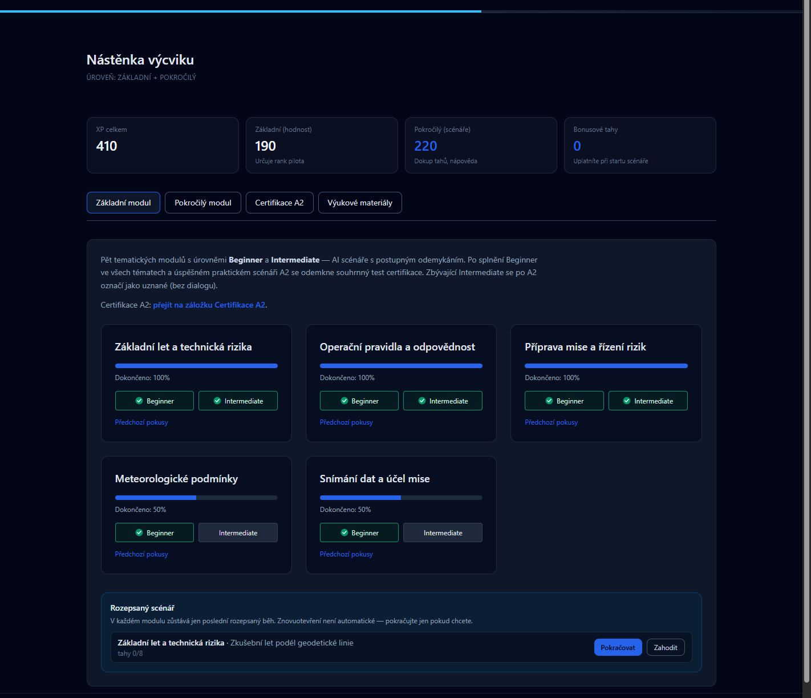
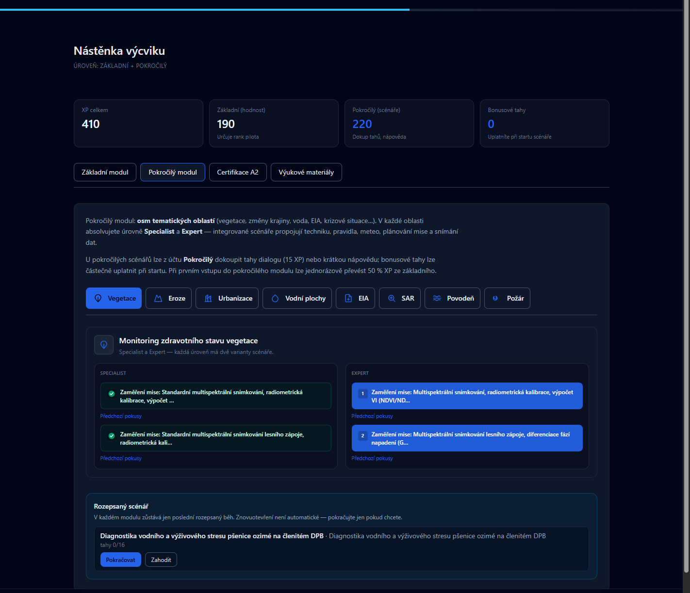
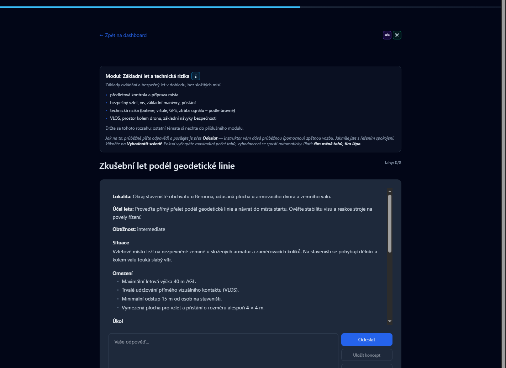

# Drone Academy

Simulovaný výcvik pilotů dronů pro studenty [Fakulty životního prostředí ČZU](https://www.fzp.czu.cz/). Studenti procházejí scénáři s AI instruktorem, získávají XP a hodnocení. Instruktoři a administrátoři spravují skupiny a obsah výcviku.

**Ostrý provoz:** [https://drone-academy-fzp-czu.web.app](https://drone-academy-fzp-czu.web.app)

Aktuální verze: **3.2.3** (říjen 2026). Přehled změn: [RELEASES.md](./RELEASES.md) · [GitHub Releases](https://github.com/LenkaMikova/DroneAcademy-public/releases).

Zdrojový kód aplikace **není veřejný**. Tento repozitář obsahuje jen informace pro zájemce: co aplikace umí a co přibylo v jednotlivých verzích.

---

## Pro koho to je

| Role | Co v aplikaci děláte |
|------|----------------------|
| **Pilot (student)** | Nástěnka výcviku, scénáře, certifikace A2, profil |
| **Instruktor** | Přehled studentů ve svých skupinách, hodnocení, udělení uznání |
| **Administrátor** | Účty, skupiny, šablony scénářů, katalogy, výzvy, kontroly |

V rozhraní se píše **základní** a **pokročilý** modul (ne Bc / Mgr). Obtížnosti zůstávají anglicky: Beginner, Intermediate, Specialist, Expert.

Přístup mají studenti a vyučující FŽP ČZU. Účet zakládá administrátor.

---

## Co aplikace umí

- Základní modul (Beginner / Intermediate) a pokročilý modul (Specialist / Expert) s dialogem s AI
- Praktický scénář a souhrnný test **A2**
- XP, hodnost, uznání (medaile) a skupinové **výzvy**
- Světlé i tmavé zobrazení, profil a avatar
- Nástěnka instruktora podle přiřazených skupin

### Náhled

Nástěnka výcviku: pět témat základního modulu, Beginner / Intermediate, XP a rozepsaný scénář.

Pokročilý modul: oblasti (vegetace, voda, EIA, …) a úrovně Specialist / Expert.

Scénář s AI instruktorem. Vedle názvu modulu je kroužek **i** na interaktivní vizuál OpenSkyLab.

---

## Verze

Krátký popis každé verze je v [RELEASES.md](./RELEASES.md). U tagged verzí stejný text najdete v [Releases](https://github.com/LenkaMikova/DroneAcademy-public/releases).

---

## Kontakt

Provozuje Fakulta životního prostředí ČZU. Dotazy k výuce směřujte na vyučující předmětu. Technické podněty k veřejným informacím lze napsat do [Issues](https://github.com/LenkaMikova/DroneAcademy-public/issues) v tomto repozitáři.
